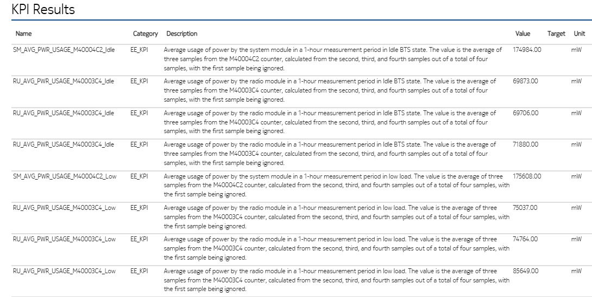
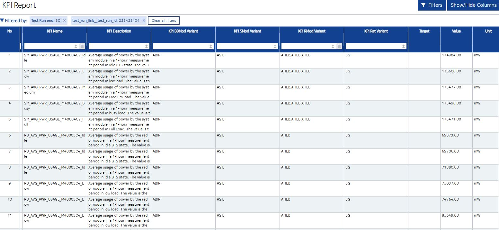

# Table of Contents
- [Energy Efficiency KPI testing and reporting](#calculating-and-reporting-oam-kpis)
  - [About procedure](#about-procedure)
  - [Sample Test Case and execution](#sample-test-case-and-execution)
  - [How it's visible in ReP?](#how-its-visible-in-rep)


# Energy Efficiency KPI testing and reporting
 - This procedure is used to measure Energy Efficiency for selected load levels - by default `Idle, Low, Medium, Busy, Full`. Each measurement(for single load level) takes 75 minutes.
 - Calculating and reporting EE KPI base on [report_ee_kpi](https://wrgitlab.ext.net.nokia.com/RAN/resource-packages/taf.rfrl.common_resources/-/tree/master/taf/rfrl/common_resources/ee_kpi?ref_type=heads)
 - The KPI results are stored in [KPI ReP](https://rep-portal.ext.net.nokia.com/reports/kpi/?category=EE_KPI&limit=25&test_run__end_db=30) to further analysis/comparison.

## About procedure
### Load level mapping to real scenarios
 - `Idle` - CellsLocked
 - `Low`  - CellsOnAir
 - `Mediurm`
   - test model - `TM1_1_ETSI` for `NR` and `E_TM1_1_ETSI` for `LTE`
   - load type: `SlotWiseLoad` 
   - load level: `load_30_medium`
 - `Busy`
   - test model - `TM1_1_ETSI` for `NR` and `E_TM1_1_ETSI` for `LTE`
   - load type: `SlotWiseLoad` 
   - load level: `load_50_busy_hour`
 - `Full`
   - test model - `TM1_1` for `NR` and `E_TM1_1` for `LTE`
   - load type: `FlatLoad` 

### High level test steps
0. Requirements - be sure that `actPowerMeter` is enabled and `mtBtsEnergyMonitoring`, `mtSBTSRfmEnergyMonitoring`, `mtSBTSSmEnergyMonitoring` are set to 15 minutes intervals.
1. Lock all cells and wait till locked(Idle state)
2. Wait for next PM period
3. Get EE counters before
4. Sleep for 75 minutes. Counters need to be calculated from 4 PM periods(first one is ignored)
5. Get EE counters after Idle state
6. Calculate and Report EE KPIs for Idle state
7. Unlock all cells and wait till OnAir state(Low state)
8. Get EE counters before
9. Sleep for 75 minutes. Counters need to be calculated from 4 PM periods(first one is ignored)
10. Get EE counters after Low state
11. Calculate and Report EE KPIs for Low state 
12. Enter TDS(Test Dedicated State) and wait for all RUs to be online 
13. Wait for Next PM Period 
14. Get EE counters before starting test model 
15. Start `Medium` test model for all configured cells(NR and LTE)
16. Sleep for 75 minutes. Counters need to be calculated from 4 PM periods(first one is ignored)
17. Stop test model 
18. Get EE counters after test model execution 
19. Calculate and Report EE KPIs 
20. Repeat steps 14 - 19 for rest of load levels (`Busy` and `Full`)
21. Site reset to exit TDS

### `Run Energy Efficiency Measurement Procedure` KW parameters
- `connection` - Admin CLI connection alias
- `cells` - List of specific cells separated by comma (e.g., `NRCELL-0,NRCELL-1, LNCEL-1`). If set to `None`, all cells on the BTS will be used. Default is `None`.
- `rus` - List of specific RUs separated by comma (e.g., `RMOD-1,RMOD-2`). If set to `None`, all RUs will be used. Ignored if `cells` is provided. Default is `None`.
- `load_levels` - Load levels separated by comma, default `Idle,Low,Medium,Busy,Full`.
- `measurment_duration` - duration of the test in seconds, default 75 minutes each loop.

Behavior based on `cells` and `rus` parameters:
- Case 1: `cells=None` and `rus=None` - The test model will run on all possible cells on the BTS.
- Case 2: `cells=['NRCELL-0', 'NRCELL-1', 'LNCELL-1']` - The test model will run only on the specified cells. The `rus` parameter is ignored.
- Case 3: `cells=None` and `rus=['RMOD-1', 'RMOD-2']` - The test model will run on cells assigned to the specified RUs.

>__Note__
> The test model will be executed in parallel on all selected cells.

## Sample Test Case and execution
In most cases you need only to provide `connection` parameter to the keyword. Other parameters are optional and have default values or wil be generated automatically.
```robot
*** Settings ***

Resource    taf/rfrl/procedures/SISO/test_models/etsi/resources/Test_Model.robot

*** Test Cases ***
Sample ETSI Test Case
    # remember to connect to ADMIN CLI - and then pass connection to the keyword
    Run Energy Efficiency Measurement Procedure
    ...                                            connection=connection_alias
```

### Sample console output

```commandline
[2025-09-15 14:08:09]    Executing EE Procedure with the following load levels: ['Idle', 'Low', 'Medium', 'Busy', 'Full']
[2025-09-15 14:08:09]        START Loop for Idle
[2025-09-15 14:08:09]            Locking cells ...
[2025-09-15 14:09:00]            Cells Locked
[2025-09-15 14:09:00]            Get EE Counters before
[2025-09-15 14:09:00]            Sleep 4500 seconds
[2025-09-15 15:24:00]            Get EE Counters after
[2025-09-15 15:24:01]            Calculate and Report EE KPI
[2025-09-15 15:24:01]        END Loop for Idle
[2025-09-15 15:24:01]        START Loop for Low
[2025-09-15 15:24:01]            UnLocking cells ...
[2025-09-15 15:24:50]            Cells OnAir
[2025-09-15 15:24:50]            Get EE Counters before
[2025-09-15 15:24:51]            Sleep 4500 seconds
[2025-09-15 16:39:51]            Get EE Counters after
[2025-09-15 16:39:51]            Calculate and Report EE KPI
[2025-09-15 16:39:51]        END Loop for Low
[2025-09-15 16:39:51]        START Loop for Medium
[2025-09-15 16:39:51]            Resetting to Test Dedicated State ...
[2025-09-15 16:44:06]            BTS in Test Dedicated State
[2025-09-15 16:44:06]            Wait for next PM period ...
[2025-09-15 16:46:30]            Get EE Counters before
[2025-09-15 16:46:31]            Executing TM1_1_ETSI for NRCELL-0
[2025-09-15 16:46:35]            Executing TM1_1_ETSI for NRCELL-1
[2025-09-15 16:46:40]            Executing TM1_1_ETSI for LNCEL-1
[2025-09-15 16:46:47]            Sleep 4500 seconds
[2025-09-15 18:01:47]            Stop all started test models
[2025-09-15 18:01:56]            Get EE Counters after
[2025-09-15 18:01:56]            Calculate and Report EE KPI
[2025-09-15 18:01:56]        END Loop for Medium
[2025-09-15 18:01:56]        START Loop for Busy
[2025-09-15 18:01:56]            BTS is already in Test Dedicated State
[2025-09-15 18:01:56]            Get EE Counters before
[2025-09-15 18:01:56]            Executing TM1_1_ETSI for NRCELL-0
[2025-09-15 18:02:01]            Executing TM1_1_ETSI for NRCELL-1
[2025-09-15 18:02:05]            Executing TM1_1_ETSI for LNCEL-1
[2025-09-15 18:02:11]            Sleep 4500 seconds
[2025-09-15 19:17:11]            Stop all started test models
[2025-09-15 19:17:21]            Get EE Counters after
[2025-09-15 19:17:21]            Calculate and Report EE KPI
[2025-09-15 19:17:21]        END Loop for Busy
[2025-09-15 19:17:21]        START Loop for Full
[2025-09-15 19:17:21]            BTS is already in Test Dedicated State
[2025-09-15 19:17:21]            Get EE Counters before
[2025-09-15 19:17:21]            Executing TM1_1 for NRCELL-0
[2025-09-15 19:17:26]            Executing TM1_1 for NRCELL-1
[2025-09-15 19:17:31]            Executing TM1_1 for LNCEL-1
[2025-09-15 19:17:36]            Sleep 4500 seconds                   
[2025-09-15 20:32:36]            Stop all started test models
[2025-09-15 20:32:46]            Get EE Counters after
[2025-09-15 20:32:46]            Calculate and Report EE KPI
[2025-09-15 20:32:46]        END Loop for Full
[2025-09-15 20:32:46]    EE Procedure with the following load levels: ['Idle', 'Low', 'Medium', 'Busy', 'Full'] have finished successfully.
[2025-09-15 20:32:46]    Reset Site to back to normal state
```

### Remarks
>__Note__
> KPI results are not reported immediately. KPI results will be parsed by **ute_reporting_portal** script and will be added to robot report.

>__Note__
> If you run test suite manually please remember to use **ute_reporting_portal** command after execution finished

>__Note__
> Please use the KW `Run Energy Efficiency Measurement Procedure` only once in a single test case. If you want to run this procedure with a different configuration, please do it in separate test cases. This is important for the proper interpretation of results in PowerBI.

## How it's visible in ReP?
- data are visble in json file
  
```json
                "kpi_results": [
                    {
                        "id": "00003",
                        "value": "174984.00",
                        "source": "EEKPI",
                        "variant": {
                            "smod": [
                                "ASIL"
                            ],
                            "rmod": [
                                "AHEB",
                                "AHEB",
                                "AHEB"
                            ],
                            "rat": [
                                "5G"
                            ],
                            "test_model": {
                                "cell": [
                                    "NRCELL-1",
                                    "NRCELL-3",
                                    "NRCELL-2"
                                ],
                                "load": [
                                    "slotWiseLoad",
                                    "slotWiseLoad",
                                    "slotWiseLoad"
                                ],
                                "pmax": [
                                    46,
                                    30,
                                    30
                                ],
                                "model": [
                                    "TM1_1_ETSI",
                                    "TM1_1_ETSI",
                                    "TM1_1_ETSI"
                                ]
                            },
                            "bbmod": [
                                "ABIP"
                            ]
                        },
                        "entity_id": "MRBTS-75115"
                    },
                    ...
                    ...
                    ...
```
  
  - each KPI is reporting in new format(similar like OAM KPIs):
    ```python
    {
      'id': <kpi_id>,             # KPI id from KPI source definitions - it's fullfiled automatically based on kpi name
      'value': <value>,           # calculated by Report EE KPI
      'variant': <variant of KPI> # generated automatically by Report EE KPI KW
      'target':  <target>         # optional
      'source': 'EEKPI'           # determine source of KPI definitions - for report_oam_kpi KW it's always OAMKPI
    }
    ```
- data are also visible in  main view of test run:
  
- and could be find also in KPI table under link: https://rep-portal.ext.net.nokia.com/reports/kpi/
  
  
  as you may have noticed - during reporting we don't provide any **KPI Name** nor **KPI Description** - such information 
  is automatically gathered from source KPI definition(which is maintained by Verification Architects)
  <br>For more info about KPI report table please check [ReP documentation](https://confluence.ext.net.nokia.com/display/LRP/KPI+Report)

